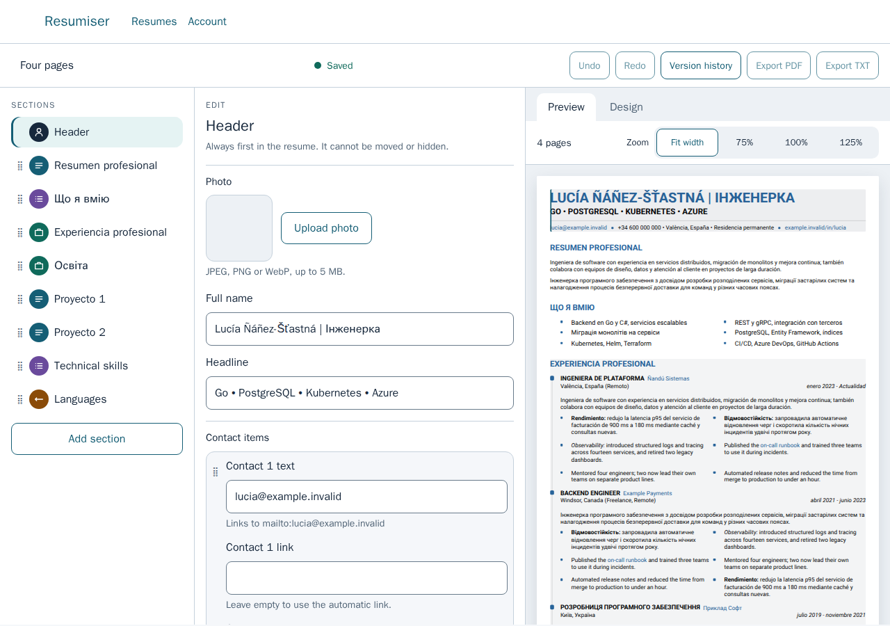

# Resume Builder — Technical Specification (stack-agnostic)

| | |
|---|---|
| Document | Functional and technical specification, stage 1 (technology-neutral) |
| Version | 0.1 draft · 2026-10-24 |
| Owner | Dmytro Vietrov (product owner) |
| Status | For review. Items marked **[DECISION]** need a product-owner choice before stage 2 |
| Next stage | Stack-specific specification (e.g. .NET + React, Ruby + Angular), built on this document |
| Inputs | Product research of resumegenius.com: [`README.md`](README.md), screenshots in [`img/`](img/), real exports in [`export/`](export/); reference template: the product owner's own CV (`docs/cv/valencia/SWE-Dmytro-Vietrov.pdf`, rendered in `img/90-*`) |

---

## Table of contents

1. Introduction
2. Product principles
3. Scope and explicit exclusions
4. Glossary and domain model
5. Functional requirements
   - 5.1 Accounts
   - 5.2 Resume library
   - 5.3 Editor workspace
   - 5.4 Header block
   - 5.5 Sections
   - 5.6 Section types and entry fields
   - 5.7 Rich text
   - 5.8 Templates
   - 5.9 Accent colors
   - 5.10 Layout controls (spacing, size, page)
   - 5.11 Preview
   - 5.12 PDF export
   - 5.13 Plain-text (TXT) export
   - 5.14 Persistence, autosave, undo
   - 5.15 Photo
6. Template T1 "Classic Timeline": detailed design specification
7. Templates T2 and T3 (proposal)
8. Pagination rules
9. TXT format specification
10. Logical data model
11. Non-functional requirements
12. Open decisions
13. Traceability to the research
- Appendix A. Screenshot index
- Appendix B. Lessons from the reference product (defects not to repeat)

Requirement IDs: `FR-<area>-<nn>` (functional), `NFR-<nn>` (non-functional).
Priority (MoSCoW): **M** must · **S** should · **C** could · **W** won't (this release).
Each requirement has acceptance criteria (AC). "RG" means the reference product, Resume Genius.

---

## 1. Introduction

### 1.1 Purpose

A web service where a user builds a resume from free-form content, picks one of three
predefined templates and one of three accent colors, tunes spacing, sees an exact preview of
the PDF, and exports the resume as **PDF** and as **plain text (TXT)**.

### 1.2 Audience

The product owner (review and decisions), and the team that writes the stage-2 stack-specific
specification: architects, backend and frontend developers, QA.

### 1.3 How this document uses the reference product

Resume Genius was studied in full (see `README.md`). This specification takes only the core
module: document editor, templates, colors, spacing, preview, export. Where RG behavior is
reused, the requirement points to an RG screenshot. Where RG has a defect, the requirement
states the corrected behavior and links the defect ID from `README.md` §12 (D1–D17).

---

## 2. Product principles

| # | Principle | What it means for the implementation |
|---|---|---|
| P1 | **No AI, no content suggestions** | The product never writes, rewrites, scores or suggests resume content. No generated bullets, no pre-written phrase libraries, no "fix my resume" (see §3.2) |
| P2 | **The user is not restricted** | Any section name, any number of sections, any order of sections and entries, any text in any field. The template decides *how* things look, never *what* the user may write or *where* a section may go |
| P3 | **Preview is the PDF** | The on-screen preview is produced by the same layout as the PDF: same pages, same line breaks, same page breaks |
| P4 | **Plain text is a first-class export** | The TXT export holds the same content in the same order as the PDF, in a documented format (§9) |
| P5 | **No dark patterns** | No upsell modals, no pre-ticked sharing or email, no leave-page warnings when nothing is unsaved (RG D8, D16, D17) |

---

## 3. Scope and explicit exclusions

### 3.1 In scope (this release)

- Accounts (minimal), resume library (create, open, duplicate, rename, delete).
- Editor workspace with live, paginated preview.
- Header block (photo, name, headline, contact items).
- Free-form sections of four generic types (§5.6), with add, rename, reorder, hide and delete.
- Rich text: bold, italic, underline, bullet lists, links.
- Three templates: **T1 "Classic Timeline"** (primary, the product owner's CV; §6) and two more (§7).
- Three accent colors per template.
- Layout controls: font-size preset, section spacing, entry spacing, line spacing, page size,
  page margins, list columns.
- PDF export and TXT export.
- Autosave and undo/redo.

### 3.2 Explicitly excluded (must NOT be built)

| # | Excluded feature | RG reference |
|---|---|---|
| X1 | Any AI assistant: generated bullet points, skills, summaries, "Refine with…", rewrite, tone change | "Sage" modals: `img/26`, `img/43`, `img/44`, `img/47` |
| X2 | Pre-written example libraries (phrases by job title) for any section | `img/27`, `img/29`, `img/31`, `img/38`, `img/45` |
| X3 | Resume score, resume checker, "your resume needs attention" | `img/77`, score widget in `img/70` |
| X4 | Content-level autosuggest from dictionaries (job titles, degrees, languages) **[DECISION D-07]** | `img/18` |
| X5 | Onboarding questionnaire (years of experience, education) | `img/06–08` |
| X6 | Template gallery with filters, more than three templates | `img/10`, `img/11` |
| X7 | Cover letters, job board, publish/share link, send by email | `img/70` top bar |
| X8 | Upload and parse an existing resume **[DECISION D-08]** | `how-to-start?flow=upload` |
| X9 | DOCX export **[DECISION D-09]** | `img/78` |
| X10 | Paywall and subscriptions **[DECISION D-10]** | RG pricing (`README.md` §1) |
| X11 | Upsell modals, promo pop-ups, tips carousels inside the flow | `img/14` "Meet Sage" |

Static help text (a short hint under a field) is allowed. It must never contain sample resume
content to copy.

---

## 4. Glossary and domain model

| Term | Definition |
|---|---|
| **Resume** | One document owned by one user. Holds content, template choice, color choice and layout settings |
| **Header** | The fixed top block of a resume: photo, full name, headline, contact items. Always first, not a section |
| **Section** | A titled block in the resume body. Has a type, a free title, a visibility flag and an order |
| **Section type** | One of `text`, `list`, `entries`, `inline` (§5.6). Defines the editing form and the TXT rendering. Templates style each type |
| **Entry** | One item inside an `entries` section (a job, a degree, a project): title, organization, location, dates, description |
| **Rich text** | Formatted text: paragraphs, bullet lists, bold, italic, underline, links (§5.7) |
| **Template** | A visual design: page structure, typography, decorations, the color roles. Content-independent |
| **Accent color** | One color from the template's three presets, applied to the template's color roles |
| **Layout settings** | Font-size preset, three spacing values, page size, margins, per-section list columns |
| **Preview** | The paginated on-screen rendering of the resume |
| **Export** | A file generated from the resume: PDF or TXT |

```
User 1 ── * Resume
Resume 1 ── 1 Header ── * ContactItem
Resume 1 ── * Section (ordered)
Section[type=entries] 1 ── * Entry (ordered)
Section[type=list]    1 ── * ListItem (ordered)
Resume ── templateId, accentColorId, LayoutSettings
```

The full logical model is in §10.

---

## 5. Functional requirements

### 5.1 Accounts

| ID | Pri | Requirement | AC |
|---|---|---|---|
| FR-ACC-01 | M | Sign up with email and password; email verification | A user can sign up, receives a verification email, and can log in only after verification **[DECISION D-01: allow login before verification?]** |
| FR-ACC-02 | M | Log in, log out, password reset by email | Standard flows work; reset link expires (default 1 h) |
| FR-ACC-03 | M | Delete account with all data | After confirmation, all resumes, photos and exports of the user are deleted within 24 h |
| FR-ACC-04 | S | Download all my data (resume JSON + latest PDF/TXT) | One archive per request |
| FR-ACC-05 | C | Sign in with Google | Optional provider **[DECISION D-02]** |
| FR-ACC-06 | C | Guest mode: build a resume without an account, keep it in the browser, claim it after sign-up **[DECISION D-03]** | |

### 5.2 Resume library

Reference: RG dashboard `img/03-dashboard-resumes.png`, create modal `img/05-create-new-modal.png`.

| ID | Pri | Requirement | AC |
|---|---|---|---|
| FR-LIB-01 | M | List of the user's resumes: title, template thumbnail (first page), last modified | Sorted by last modified, newest first. Loads within NFR-02 |
| FR-LIB-02 | M | Create resume: **blank** or **copy of an existing resume** | Blank resume gets the default section set (FR-SEC-01), template T1, default color, default layout. A copy duplicates everything incl. photo, layout and order |
| FR-LIB-03 | M | Rename resume (title up to 150 chars) | The title is also the default export file name (FR-PDF-06) |
| FR-LIB-04 | M | Delete resume with confirmation; deleted resumes go to a trash for 30 days **[DECISION D-04]** | The resume disappears from the list; can be restored from trash within the period |
| FR-LIB-05 | M | Open resume in the editor | Opens the editor workspace (§5.3) at the last selected section |
| FR-LIB-06 | S | Export PDF / TXT directly from the list | Same output as from the editor |

### 5.3 Editor workspace

Single-page editor. RG splits editing into an 11-step wizard (`img/15`…`img/60`) plus a final
screen (`img/70`). This product uses **only the final-screen concept**: one workspace where all
content is editable and the preview is always visible. **[DECISION D-05: add an optional guided
first run?]**

Layout (desktop, ≥ 1280 px wide):

```
┌───────────────┬───────────────────────────────┬───────────────────────────┐
│ Section panel │ Editing panel                 │ Preview panel             │
│ - Header      │ form for the selected section │ paginated pages (§5.11)   │
│ - sections…   │ or entry                      │ zoom, page count          │
│ [+ Add]       │                               │ Design: template, color,  │
│               │                               │ layout controls           │
└───────────────┴───────────────────────────────┴───────────────────────────┘
Top bar: resume title (editable) · save status · Undo / Redo · Export PDF · Export TXT
```

| ID | Pri | Requirement | AC |
|---|---|---|---|
| FR-EDT-01 | M | Three panels: section panel, editing panel, preview panel | All three visible at 1280 px; editing changes appear in the preview within NFR-01 |
| FR-EDT-02 | M | Section panel lists Header + all sections in document order, with type icon, title, hidden state | Same order as the preview. Reference for list look: RG sidebar `img/70` (left) |
| FR-EDT-03 | M | Clicking a section in the panel opens its form and scrolls the preview to it | Preview scroll lands within ±1 line of the section top |
| FR-EDT-04 | S | Clicking a section in the preview selects it (opens its form) | Reference: RG hover tools on preview `img/64`, `img/67` |
| FR-EDT-05 | M | Design controls (template, color, layout) live in a "Design" tab of the preview panel | Reference: RG "Templates / Formatting" tabs `img/70`, `img/71` |
| FR-EDT-06 | M | Top bar: editable resume title, save status ("Saved" / "Saving…" / "Offline, changes kept locally"), Undo, Redo, Export PDF, Export TXT | |
| FR-EDT-07 | S | Narrow screens (< 1024 px): panels become tabs (Sections / Edit / Preview / Design) | Every function reachable on a 390 px wide phone |
| FR-EDT-08 | M | No leave-page warning when all changes are saved | Warning only if unsaved changes exist (fixes RG D16) |

### 5.4 Header block

The header is not a section: it is always first and cannot be moved, hidden or deleted.
Reference rendering: `img/91-template-T1-header-detail.png`.

| ID | Pri | Requirement | AC |
|---|---|---|---|
| FR-HDR-01 | M | Field **Full name**, free text up to 120 chars | Any characters, incl. separators like `|` (the reference CV writes "Dmytro Vietrov \| Software Engineer") |
| FR-HDR-02 | M | Field **Headline**, free text up to 200 chars, optional | Rendered under the name (T1: "C# • .NET • SQL • AZURE • KUBERNETES • AI") |
| FR-HDR-03 | M | **Contact items**: ordered list, each item = free text (up to 200 chars) + optional URL | The user can add, edit, reorder (drag + up/down), delete items. No fixed field set: e-mail, phone, city, residency, LinkedIn, GitHub, anything. (RG has fixed fields and the reference CV abuses the City field to print "phone • city • residency" — `README.md` §4.1) |
| FR-HDR-04 | M | Auto-link: a contact item that is a valid e-mail gets `mailto:`, a valid phone gets `tel:`, a text that looks like a URL gets `https://` if no scheme | `@handle` is **not** turned into a URL (fixes RG D3). The user can always override the URL |
| FR-HDR-05 | S | Item type hint (email / phone / location / link / other) for templates that show icons | T1 shows no icons; T2 shows icons (`img/66`) |
| FR-HDR-06 | M | Photo: optional (§5.15) | Header layout without a photo per template spec (§6.3) |

### 5.5 Sections

| ID | Pri | Requirement | AC |
|---|---|---|---|
| FR-SEC-01 | M | A new blank resume contains these sections, all editable and removable: Professional Summary (`text`), Professional Experience (`entries`), Education (`entries`), Skills (`list`), Languages (`inline`) | **[DECISION D-06: default set]** |
| FR-SEC-02 | M | **Add section**: pick a type (`text` / `list` / `entries` / `inline`), enter any title | No limit on the number of sections, incl. several of the same type. Reference for "custom section" idea: `img/60` |
| FR-SEC-03 | M | **Rename** a section: inline in the section panel and in the editing form, up to 80 chars | The new title appears in the panel, preview, PDF and TXT. Letter case is stored as typed; templates may display it uppercase (RG renames: `img/67`) |
| FR-SEC-04 | M | **Reorder** sections: drag-and-drop in the section panel **and** "Move up / Move down" buttons (keyboard accessible) | Any body section can go to any body position. **No template zones restrict the order** (fixes RG §6.3, where Skills could not leave its zone). Order is identical in preview, PDF and TXT |
| FR-SEC-05 | M | **Hide / show** a section without deleting it | Hidden sections are not rendered in preview, PDF or TXT, but stay in the editor (greyed) |
| FR-SEC-06 | M | **Delete** a section with confirmation; undo available | Undo restores the section with content and position (RG has no undo: D-ref §6.4) |
| FR-SEC-07 | M | Empty sections (no content) are not rendered | Matches RG; the panel marks them "empty" |
| FR-SEC-08 | M | Reorder entries / list items inside a section: drag-and-drop and up/down | No automatic sorting by dates (RG behavior, `img/35`), order is manual |
| FR-SEC-09 | S | Change the type of an existing section when content allows (e.g. `list` ↔ `text` keeps the lines) | Lossless conversions only; otherwise disabled with a hint |
| FR-SEC-10 | S | Duplicate a section or an entry | Copy is placed right after the original |
| FR-SEC-11 | M | Per-section option **List columns: 1 or 2** for bullet lists in this section | Default per template (T1: Experience description and Skills lists = 2, others = 1). Applies to preview, PDF; TXT ignores it |

### 5.6 Section types and entry fields

| Type | Editing form | Typical use | RG equivalent |
|---|---|---|---|
| `text` | One rich-text field | Summary, "How we can work together", Interests | SUMM, CUST |
| `list` | Ordered list of items; each item is a single rich-text line (inline formatting and links, no nested lists) | Skills, "What I can help with", Certifications, Awards | HILT, CERT, AWAR |
| `entries` | Ordered list of entries with the entry form below | Experience, Education, Projects, Volunteering | EXPR, EDUC, VLTR |
| `inline` | One rich-text paragraph, rendered as a single flowing paragraph | Languages ("English - B2 \| Spanish - B1 …"), short lists | the reference CV's custom "Languages" |

**Entry form** (one schema for all `entries` sections; labels are editable per section **[DECISION D-11]**):

| Field | Type | Rules |
|---|---|---|
| Title | text ≤ 150 | e.g. "Software Engineer", "Institute for AI Problems" |
| Organization | text ≤ 150, optional | e.g. "Cayzu Inc"; T1 prints it in accent color after the title |
| Location | text ≤ 150, optional | free text ("Canada, Windsor (Freelance, Remote)") |
| Start date | month + year, or year only, optional | picker + typing |
| End date | month + year, or year only, or **Present**, optional | checkbox "Present" (RG: `img/25`) |
| Date text override | text ≤ 60, optional | when set, printed instead of computed dates ("Summer 2019", "2005–2013, part-time") |
| Description | rich text (§5.7) | paragraphs and bullet lists mixed (as in the reference CV: one intro paragraph + bullets) |

Date display format is a resume-level setting: `October 2025` (default, as in the reference CV),
`Oct 2025`, `10/2025`, `2025`. "Present" label follows the resume language (FR-LAY-09).
The same format is used in preview, PDF and TXT (fixes RG T6: `Jan` in TXT vs `January` in PDF).

| ID | Pri | Requirement | AC |
|---|---|---|---|
| FR-TYP-01 | M | All four section types exist with the forms above | |
| FR-TYP-02 | M | Entry dates: start ≤ end validation is a **warning, not a block** | The user can save any combination (P2) |
| FR-TYP-03 | M | No field is mandatory, except the resume needs at least a full name to export | Export button explains what is missing |

### 5.7 Rich text

Reference: RG editor toolbar `img/27`, link dialog `img/30`, result in PDF `img/84`.

| ID | Pri | Requirement | AC |
|---|---|---|---|
| FR-RTE-01 | M | Bold, italic, underline; keyboard shortcuts Ctrl/Cmd+B/I/U | Rendered identically in preview and PDF |
| FR-RTE-02 | M | Bullet list (one level) mixed with paragraphs in one field | First paragraph plain + bullets below works (RG tested: `img/28`) |
| FR-RTE-03 | M | Links: select text → "Link" → URL; edit and remove link | Clickable in PDF; in TXT rendered per §9 (fixes RG T5) |
| FR-RTE-04 | M | Paste from Word / Google Docs / web keeps only supported formatting, strips the rest | Pasted bullets become list items; fonts, colors, sizes are dropped |
| FR-RTE-05 | M | Undo / redo inside the field and at document level (FR-PER-04) | |
| FR-RTE-06 | S | Line break inside a paragraph (Shift+Enter) | |
| FR-RTE-07 | W | Numbered lists, nested lists, headings, colors, font sizes inside text | Design comes from the template only |
| FR-RTE-08 | M | Spelling: the browser's native spell checker is enabled in all text fields | No own spell-check service (RG has one; low value: `README.md` §11) |

### 5.8 Templates

| ID | Pri | Requirement | AC |
|---|---|---|---|
| FR-TPL-01 | M | Three templates: **T1 Classic Timeline** (default), **T2**, **T3** (§7) **[DECISION D-12]** | |
| FR-TPL-02 | M | Template picker in the Design tab: three thumbnails rendered with the user's own content | Reference: RG live thumbnails `img/70` (right) |
| FR-TPL-03 | M | Switching template keeps all content, section order, hidden flags, color choice (mapped to the same preset index) and layout settings | Switching T1 → T2 → T1 restores the exact previous rendering (RG keeps order: `README.md` §6.3) |
| FR-TPL-04 | M | A template never changes section order and never moves sections into other zones | Fixes RG behavior where a two-column template re-distributes sections (`img/76`) **[DECISION D-13 for T3 sidebar]** |
| FR-TPL-05 | M | Templates are data-driven design definitions separate from content (design tokens + layout rules) | Adding a fourth template later needs no change to the content model |

### 5.9 Accent colors

Reference: RG palette `img/70`, color roles measured in `README.md` §7.2.

| ID | Pri | Requirement | AC |
|---|---|---|---|
| FR-CLR-01 | M | Each template offers exactly **three accent colors**; one is selected per resume | Selected swatch shows a check mark |
| FR-CLR-02 | M | T1 presets: **Blue `#2A68A0`** (default, the reference CV), **Navy `#335776`**, **Graphite `#333333`** **[DECISION D-14]** | All three have contrast ≥ 4.5:1 on white (WCAG AA for text). Fixes RG D6 (light colors were unreadable) |
| FR-CLR-03 | M | The accent color applies to the template's color roles only (§6.2 for T1). Body text stays near-black | Changing color repaints all roles in preview and PDF |
| FR-CLR-04 | W | Free color picker / custom hex | Keeps the design controlled |

### 5.10 Layout controls

Reference: RG "Font size" and "More font settings" `img/71`; measured formulas in `README.md` §7.4–7.5.

| ID | Pri | Control | Range / options | Default (T1) | Effect | AC |
|---|---|---|---|---|---|---|
| FR-LAY-01 | M | Font size preset | Small / Medium / Large | Medium | Scales all template font sizes: Small ×0.9, Medium ×1.0, Large ×1.2 **[DECISION D-15]** | Every text style changes; spacing controls keep their values (RG changes line spacing silently with the preset — not repeated) |
| FR-LAY-02 | M | Section spacing | 0–20, step 1 | 10 | Space above each section title = `10 + v` pt (RG formula) | Measured in PDF within ±0.5 pt |
| FR-LAY-03 | M | Entry spacing | 0–20, step 1 | 10 | Space between two entries / list items blocks = `v` pt | Same |
| FR-LAY-04 | M | Line spacing | 0–20, step 1 | 1 | Line height = `round(font size × 1.2) + v × 0.5` pt **[DECISION D-16: RG uses +1 px per step, which is very coarse: 0→20 grew the document by 82%]** | |
| FR-LAY-05 | M | Page size | A4 / US Letter | **A4** | Page geometry of preview and PDF | RG offers Letter only (D7) |
| FR-LAY-06 | S | Page margins | Narrow 16 pt / Normal 23 pt / Wide 36 pt, or custom 10–50 pt | Normal 23 pt (reference CV) | All four sides; top margin of continuation pages per §6.3 | Not available in RG |
| FR-LAY-07 | M | Reset design | — | — | Resets FR-LAY-01…06 and FR-SEC-11 to template defaults, color to default; with undo | RG splits this into two resets |
| FR-LAY-08 | S | Body font | 3 fonts per template | T1: Roboto | Headings may use the same or a template-defined font | RG offers 12 fonts for body text only (`img/73`) |
| FR-LAY-09 | S | Resume language | English / Spanish / Ukrainian / … | English | Affects month names, "Present" label, hyphenation dictionary | |
| FR-LAY-10 | M | Every layout change is applied to the preview within NFR-01 and stored with the resume | Persists across sessions (RG verified) |

Slider UX: value label visible, keyboard arrows ±1, Home/End to min/max, double-click resets to
default.

### 5.11 Preview

| ID | Pri | Requirement | AC |
|---|---|---|---|
| FR-PRV-01 | M | The preview shows **separate pages** of the selected page size, with visible gaps between pages and page numbers "1 / 3" | Fixes RG D4 (continuous canvas, page count unknown until download) |
| FR-PRV-02 | M | **WYSIWYG contract**: preview and PDF use the same layout result. Same number of pages, same content on each page, same line breaks | Automated test: for a set of fixture resumes, text per page and line breaks extracted from the PDF equal those of the preview layout; visual diff ≤ 1% pixels at 100 dpi |
| FR-PRV-03 | M | Live update while typing | Within NFR-01 |
| FR-PRV-04 | M | Page counter in the Design tab next to the spacing controls | The user sees "3 pages" change while moving a slider |
| FR-PRV-05 | S | "Fit to N pages" helper: reduces line spacing, then entry spacing, then section spacing, then font preset until the resume fits N pages, or reports that it cannot | Never changes content |
| FR-PRV-06 | M | Zoom: fit width, 75%, 100%, 125% | |
| FR-PRV-07 | S | Overflow hints: highlight a section title left alone at the bottom of a page (should not happen with §8 rules; kept as a safety net) | |
| FR-PRV-08 | M | Clicking an element in the preview selects the corresponding section/entry in the editor | See FR-EDT-04 |

### 5.12 PDF export

| ID | Pri | Requirement | AC |
|---|---|---|---|
| FR-PDF-01 | M | One-click "Export PDF" (no wizard) | File downloads; no modal, no e-mail, no share link (fixes RG D8, D17; RG flow `img/77`, `img/78`) |
| FR-PDF-02 | M | Vector text, selectable and searchable; fonts embedded (subset) | `pdffonts` lists all fonts as embedded; copying text gives the typed characters, incl. Cyrillic and Spanish diacritics |
| FR-PDF-03 | M | Clickable links (contact items, links in rich text) | URL as defined by FR-HDR-04 / FR-RTE-03 |
| FR-PDF-04 | M | Page size and margins as in layout settings; pagination per §8 | |
| FR-PDF-05 | M | Metadata: Title = full name + headline, Author = full name, Creator = product name, Language = resume language | |
| FR-PDF-06 | M | File name = resume title, sanitized: keep letters, digits, `-`, `_`, `.`; spaces → `-` | "SWE-Dmytro-Vietrov" → `SWE-Dmytro-Vietrov.pdf` (RG strips dashes: D15) |
| FR-PDF-07 | M | Photo embedded at ≥ 200 dpi for its printed size, JPEG quality ≥ 85 | Reference CV: 243×251 px for a 70 pt box |
| FR-PDF-08 | S | PDF/UA-style tagging (headings, lists, reading order) for ATS and screen readers | |
| FR-PDF-09 | M | Output size ≤ 1 MB for a 4-page resume with photo | RG: 76 KB without photo |
| FR-PDF-10 | M | Generation time within NFR-03 | |

### 5.13 TXT export

"Save / export as text" is a separate function next to Export PDF.

| ID | Pri | Requirement | AC |
|---|---|---|---|
| FR-TXT-01 | M | One-click "Export TXT" | Downloads `<sanitized title>.txt` |
| FR-TXT-02 | M | Content and **order identical to the PDF** (header, then visible non-empty sections in document order) | Fixes RG D1 (Summary moved to the end) |
| FR-TXT-03 | M | No section is lost | Fixes RG D2 (Websites dropped) |
| FR-TXT-04 | M | Format per §9: UTF-8 without BOM, LF line endings, no service comments, no trailing spaces | Fixes RG D14, T7 |
| FR-TXT-05 | S | Option: line endings CRLF (Windows) | |
| FR-TXT-06 | S | "Copy as text" to clipboard, same content | |
| FR-TXT-07 | M | Section titles and all texts exactly as typed (no forced uppercase) | TXT for "Tech Stack" prints `Tech Stack` |

### 5.14 Persistence, autosave, undo

| ID | Pri | Requirement | AC |
|---|---|---|---|
| FR-PER-01 | M | Autosave every change (debounced ≤ 1 s after the last edit) | Reloading the page shows the last edit |
| FR-PER-02 | M | Offline tolerance: edits made while offline are kept locally and synced on reconnect | Status shows "Offline, changes kept locally" |
| FR-PER-03 | M | Concurrency: the same resume open in two tabs does not silently lose edits | Last-writer conflict shows a notice and keeps both versions **[DECISION D-17: merge or reload]** |
| FR-PER-04 | M | Document-level undo/redo (≥ 50 steps per session) for content, structure (add/move/delete section) and design changes | Ctrl/Cmd+Z, Ctrl/Cmd+Shift+Z |
| FR-PER-05 | S | Version history: restore a snapshot from the last 30 days | Snapshot at most every 10 min of editing and before each export |

### 5.15 Photo

Reference: RG photo flow (`README.md` §4.1, `.claude/skills/hunt/resumegenius.md` "Photo").

| ID | Pri | Requirement | AC |
|---|---|---|---|
| FR-PHO-01 | M | Upload JPEG/PNG/WebP up to 5 MB; crop to the template's aspect ratio (T1: square) with zoom and pan | |
| FR-PHO-02 | M | Replace and remove photo | Removing re-flows the header (§6.3) |
| FR-PHO-03 | M | Photo is stored per resume; duplicated with the resume | |
| FR-PHO-04 | S | "Show photo" toggle without deleting it | Useful for applications where photos are not wanted |
| FR-PHO-05 | M | The original upload is kept; the cropped rendition is regenerated on crop changes | |

---

## 6. Template T1 "Classic Timeline": detailed design specification

T1 reproduces the product owner's CV, built in RG with template **SLO3 "Classic"**, accent
Blue `#2A68A0`, font Roboto, size Default, Section/Paragraph/Line spacing = 10/10/1.
Values below were measured in the RG preview DOM and in the exported PDF (1 CSS px = 1 pt).

Reference renders: `img/90-template-T1-reference-1.png` … `-4.png` (full pages),
`img/91-template-T1-header-detail.png`, `img/92-template-T1-timeline-detail.png`,
`img/93-template-T1-education-skills-detail.png`.



_The reference CV and its renders (`img/90-*`…`93-*`) are not published: they hold the owner's personal data._

### 6.1 Page

| Token | Value |
|---|---|
| Page | A4 595×842 pt or Letter 612×792 pt (FR-LAY-05). Reference was Letter |
| Margins | 23 pt left / right / top on page 1; **≈ 31 pt top on continuation pages**; 23 pt bottom |
| Content width | page width − 46 pt (566 pt on Letter, 549 pt on A4) |
| Background | white |
| Body text color | `#050505` |
| Columns | single-column body |

### 6.2 Typography and color roles (Medium preset)

| Element | Font | Size / line height | Weight / style | Case | Color |
|---|---|---|---|---|---|
| Full name | Roboto | 24 / 31 pt | Bold | UPPERCASE (display) | **accent** |
| Headline | Roboto | 14 / 18 pt | Bold | UPPERCASE | `#050505` |
| Contact line | Roboto | 10 / 13 pt | Regular | as typed | `#050505`; links `#0000EE` underlined **[DECISION D-18: links in accent color?]** |
| Section title | Roboto | 14 / 18 pt | Bold | UPPERCASE | **accent** |
| Body text (paragraphs) | Roboto | 10 / 13 pt (summary 10 / 14) | Regular | as typed | `#050505` |
| `list`-section items | Roboto | 11 / 14 pt | Regular | as typed | `#050505` |
| Entry title | Roboto | 11 / 14 pt | Bold | UPPERCASE | `#050505` |
| Entry organization | Roboto | 10 / 13 pt | Regular | as typed | **accent** |
| Entry location | Roboto | 10 / 13 pt | Regular | as typed | `#050505` |
| Entry dates | Roboto | 10 / 13 pt | Italic | as typed | `#050505`, right-aligned |
| Bold inside rich text | Roboto | inherit | Bold | | inherit |
| Decorative lines | — | 1 pt | — | — | `#CDCDCD` |

**Accent color roles in T1:** full name, section titles, entry organization, all bullet
markers, contact-line separators, timeline dots. Everything else is neutral.

### 6.3 Header

Reference: `img/91-template-T1-header-detail.png`.

```
┌──────────┐  DMYTRO VIETROV | SOFTWARE ENGINEER          ← name, accent, 24 pt bold caps
│  photo   │  C# • .NET • SQL • AZURE • KUBERNETES • AI   ← headline, 14 pt bold caps
│ 70×70 pt │  ─────────────────────────────────────────   ← 1 pt rule #CDCDCD, full width of the text column
└──────────┘  e-mail  ▪ +34… • Paterna, Valencia…  ▪ linkedin.com/in/…   ← contact items, 10 pt
```

| Element | Rule |
|---|---|
| Photo | 70×70 pt, corner radius 9 pt, at the top-left margin corner |
| Text column | starts 20 pt right of the photo (x = margin + 90 pt); width = content width − 90 pt |
| Without photo | text column starts at the left margin and takes the full content width |
| Name ↔ headline | headline directly under the name (no extra gap) |
| Rule | 1 pt `#CDCDCD` under the headline, 54 pt below the top of the name block; full text-column width |
| Contact items | 6 pt below the rule; inline, wrapping; between two items a 4×4 pt accent square (corner radius 1 pt), 19 pt horizontal slot (marker centered-left, text after 19 pt) |
| Separator at line start | **Not rendered** when an item wraps to the start of a new line. (The reference CV shows a stray marker before "linkedin.com" on line 2 — fix it) |
| Header ↔ first section | first section title starts 20 pt (section spacing default) below the header bottom |

### 6.4 Section title

- 14 pt bold uppercase, accent color; 10 pt gap to the section content; no underline.
- Space above = section spacing (FR-LAY-02); the first section after the header uses the same.

### 6.5 `text` section (e.g. Professional Summary)

Plain paragraphs, full content width, 10 pt / 14 pt. Paragraph gap 6 pt.

### 6.6 `list` section (e.g. "What I can help with", Skills)

Reference: `img/90-template-T1-reference-1.png`, block "WHAT I CAN HELP WITH".

- Items flow in **2 columns** by default (FR-SEC-11), filled row by row (left, right, next row).
  Column width = (content width − 20 pt) / 2; item text indent 37 pt from the column edge
  (18 pt column padding + 19 pt marker slot).
- Marker: 4×4 pt accent square, corner radius 1 pt, 4 pt below the item's first-line top,
  19 pt left of the text.
- Gap between rows: 5 pt.
- With 1 column (as "TECHNICAL SKILLS" in the reference CV, `img/93`): same marker, item text
  indent 19 pt, 10 pt / 13 pt text, 5 pt between items. Bold prefix ("**Databases**: …") is
  ordinary rich-text bold.

### 6.7 `entries` section with timeline (Experience, Education)

Reference: `img/92-template-T1-timeline-detail.png`.

```
│
■  CLOUD DEVOPS ENGINEER  SAP                              ← title 11 pt bold caps + organization (accent) after 5 pt
│  Slovakia, Bratislava (On-Site)          February 2023 - June 2025   ← location left, dates italic right
│
│     ▪ bullet in column 1            ▪ bullet in column 2
│     ▪ …                             ▪ …
│
■  .NET SOFTWARE DEVELOPER  Cayzu Inc
```

| Element | Rule |
|---|---|
| Entry block | indented 18 pt from the content left edge |
| Timeline line | vertical 1 pt line `#CDCDCD`, 3 pt from the content left edge, from 2 pt below the entry top to the next entry; continuous through all entries of the section; across a page break it continues from the top of the next page's part of the entry |
| Timeline dot | 7×8 pt accent rectangle, corner radius 2 pt, on the line, aligned with the title's first line (2 pt from top) |
| Title row | title (11 pt bold caps) then organization (10 pt accent), 5 pt gap, on one line, wraps if needed |
| Meta row | location (left) and dates (right, italic) on one line; if both do not fit, dates go to their own right-aligned line |
| Description | starts 12 pt under the meta row. Paragraphs: full entry width. Bullet lists: 2 columns by default, column width = (entry width − 19 pt − 20 pt) / 2, marker as §6.6, 10 pt between rows |
| Gap between entries | entry spacing (FR-LAY-03), default 10 pt, plus the description's last row gap |
| Education variant | same block; the "Organization" field prints on the meta row in accent color before the location (reference: "MASTER'S DEGREE in … , Donetsk, Ukraine" in `img/93`) **[DECISION D-19: unify with Experience?]** |
| Single-entry section | the timeline line is not drawn (dot only), as in the reference Education |

### 6.8 `inline` section (Languages)

One paragraph, 10 pt / 13 pt, full content width; rich text bold allowed
(reference: "**English** - Professional B2 | **Spanish** - Conversation B1 | …", `img/90-…-4.png`).

### 6.9 Size presets for T1

| Element | Small (×0.9) | Medium | Large (×1.2) |
|---|---|---|---|
| Name | 21.5 pt | 24 pt | 29 pt |
| Section title / headline | 12.5 pt | 14 pt | 17 pt |
| Entry title, list item | 10 pt | 11 pt | 13 pt |
| Body | 9 pt | 10 pt | 12 pt |

Photo size, markers and lines do not scale **[DECISION D-15]**.

---

## 7. Templates T2 and T3 (proposal) [DECISION D-12]

Two more templates are needed. Proposal, based on RG templates studied in the research:

| | T2 "Compact" | T3 "Sidebar" |
|---|---|---|
| Based on | RG SLO7 "Advanced" (`img/66`, `img/84`) | RG MLO1 "Corporate" (`img/76`) |
| Layout | Single column; contact items as rounded "chips" with icons; skills as chips | Accent header band with name and headline; two columns: main (≈ 64%) and sidebar (≈ 36%) |
| Accent roles | headline, organizations, dates color, header rule | header band background, section titles |
| Section placement | any order (single zone) | sections are placed in the column chosen **per section by the user** ("Main" / "Sidebar"), default Skills, Languages → sidebar; order kept within each column. The template never moves sections by itself (FR-TPL-04) |
| Photo | none | optional, round, in the header band |

---

## 8. Pagination rules

RG breaks pages by lines only: entry headers are cut from their bullets and section titles
are left alone at a page bottom (`img/81`, README §9.3). This product must apply:

| ID | Rule |
|---|---|
| PG-01 | A section title is never the last element on a page: keep it with at least the first 2 lines of its content |
| PG-02 | An entry's title row and meta row are kept together and with at least the first 2 lines of its description |
| PG-03 | A single bullet item is not split across pages if it is ≤ 4 lines; longer items may split, leaving ≥ 2 lines on each page (widow/orphan control) |
| PG-04 | Paragraphs keep ≥ 2 lines on each side of a break |
| PG-05 | In 2-column bullet lists a page break happens between rows, never between the two cells of a row |
| PG-06 | The header is never split |
| PG-07 | The timeline line of T1 continues on the next page for a split entry; no dot is repeated |
| PG-08 | Option per entry: "Start on a new page" (manual page break) | S |
| PG-09 | If a rule cannot be satisfied (e.g. one item longer than a page), break by lines and show FR-PRV-07 hint |

---

## 9. TXT format specification

### 9.1 Encoding

UTF-8, no BOM, LF line endings (CRLF optional, FR-TXT-05), no trailing spaces, no tabs, no
markup, no service comments, no hard wrapping of long lines.

### 9.2 Grammar

```
<Full name>
<Headline>                                   (omitted if empty)
<contact 1> | <contact 2> | …                (one line, " | " separated; links per 9.3)
<blank line>
<SECTION>*

SECTION  := <Section title as typed> NL <blank line> <body by type> NL <blank line>

text     := paragraphs, one blank line between paragraphs; bullets per "list item"
list     := one item per line, each prefixed "- "
inline   := one paragraph
entries  := ENTRY (<blank line> ENTRY)*
ENTRY    := <Title>[ — <Organization>] NL
            [<Location>][ | <Dates>] NL          (line omitted if both empty)
            <description: paragraphs; bullets prefixed "- ">
```

### 9.3 Inline rules

| Element | TXT rendering |
|---|---|
| Bold, italic, underline | dropped (plain text) |
| Link with text ≠ URL | `text (https://url)` |
| Link with text = URL | `https://url` once |
| Dates | same display format as the PDF (FR-TYP / date format setting) |
| Hidden or empty sections | omitted |
| Section and field letter case | as typed (no template uppercase) |

### 9.4 Example (from the reference CV)

```
Dmytro Vietrov | Software Engineer
C# • .NET • SQL • Azure • Kubernetes • AI
candidate.cv@example.com | +34600000000 • Paterna, Valencia, Spain • Permanent Resident | linkedin.com/in/dmvietrov (https://linkedin.com/in/dmvietrov)

Professional Summary

Software Engineer with 8+ years of experience building backend services, REST APIs, and cloud-based solutions. …

What I Can Help With

- C# / .NET / ASP.NET Core development - built and maintain scalable web applications
- Backend development, bug fixing and maintenance, implement new features

Professional Experience

Software Engineer — Cayzu Inc
Canada, Windsor (Freelance, Remote) | October 2025 - Present
Worked as a backend developer for a helpdesk SaaS platform for non-profit educational organizations in Canada, focusing on moving the backend from a monolith to services:
- Decomposed a legacy ASP.NET Core MVC help desk monolith into standalone .NET 8 Minimal API services, …
- Decoupled a Notification service from the monolith: …

Cloud DevOps Engineer — SAP
Slovakia, Bratislava (On-Site) | February 2023 - June 2025
- Developed a GitHub-based self-service workflow for on-demand Kubernetes cluster provisioning.

Languages

English - Professional B2 | Spanish - Conversation B1 | Ukrainian & Russian - Native | Slovak - Advanced
```

Compare with the RG TXT (`export/A-default.txt`, README §10): service comment, wrong order,
lost section, mixed line endings — all removed here.

---

## 10. Logical data model

Technology-neutral. Types: `string`, `int`, `bool`, `date`, `uuid`, `enum`, `richText` (§10.2).

### 10.1 Entities

```
User           { id: uuid, email: string, passwordHash, emailVerifiedAt?, createdAt, deletedAt? }

Resume         { id: uuid, ownerId: uuid, title: string(150),
                 templateId: enum(T1,T2,T3), accentPreset: int(0..2),
                 layout: LayoutSettings, header: Header,
                 sections: Section[] (ordered), language: enum(en,es,uk,…),
                 dateFormat: enum(MonthYearLong, MonthYearShort, Numeric, YearOnly),
                 version: int, createdAt, updatedAt, deletedAt? }

LayoutSettings { fontPreset: enum(S,M,L), sectionSpacing: int(0..20),
                 entrySpacing: int(0..20), lineSpacing: int(0..20),
                 pageSize: enum(A4, Letter), margins: { top, right, bottom, left: number pt },
                 bodyFont?: string }

Header         { photo?: Photo, showPhoto: bool, fullName: string(120),
                 headline?: string(200), contacts: ContactItem[] (ordered) }

ContactItem    { id: uuid, text: string(200), url?: string, kind: enum(email,phone,location,link,other) }

Section        { id: uuid, type: enum(text,list,entries,inline), title: string(80),
                 hidden: bool, listColumns: enum(1,2)?, placement?: enum(main,sidebar) /*T3*/,
                 content: TextContent | ListContent | EntriesContent }

TextContent    { body: richText }                        // also used by `inline`
ListContent    { items: { id, text: richTextInline }[] }  // ordered
EntriesContent { labels?: {title,organization,location}, entries: Entry[] }  // ordered

Entry          { id: uuid, title?: string(150), organization?: string(150), location?: string(150),
                 start?: { year: int, month?: int(1..12) }, end?: { year, month? } | "present",
                 dateText?: string(60), description?: richText, pageBreakBefore: bool }

Photo          { id: uuid, originalFileRef, croppedFileRef, crop: { x, y, w, h }, mime, bytes }
```

### 10.2 Rich text

Stored as a structured, format-neutral tree (not HTML):

```
richText       := Block[]
Block          := Paragraph { inlines: Inline[] } | BulletList { items: Inline[][] }
Inline         := Text { value, bold?, italic?, underline? } | Link { url, children: Text[] } | LineBreak
richTextInline := Inline[]
```

Reason: the same tree feeds the preview renderer, the PDF renderer and the TXT serializer
(P3, P4), and cannot carry unsupported formatting from paste (FR-RTE-04).

### 10.3 Example (fragment of the reference CV)

```json
{
  "title": "SWE-Dmytro-Vietrov",
  "templateId": "T1", "accentPreset": 0,
  "layout": { "fontPreset": "M", "sectionSpacing": 10, "entrySpacing": 10, "lineSpacing": 1,
              "pageSize": "A4", "margins": { "top": 23, "right": 23, "bottom": 23, "left": 23 } },
  "header": {
    "showPhoto": true, "fullName": "Dmytro Vietrov | Software Engineer",
    "headline": "C# • .NET • SQL • Azure • Kubernetes • AI",
    "contacts": [
      { "text": "candidate.cv@example.com", "kind": "email" },
      { "text": "+34600000000 • Paterna, Valencia, Spain • Permanent Resident", "kind": "other" },
      { "text": "linkedin.com/in/dmvietrov", "url": "https://linkedin.com/in/dmvietrov", "kind": "link" }
    ]
  },
  "sections": [
    { "type": "text", "title": "Professional Summary", "content": { "body": [ { "Paragraph": "…" } ] } },
    { "type": "list", "title": "What I can help with", "listColumns": 2, "content": { "items": [ "…" ] } },
    { "type": "entries", "title": "Professional Experience", "content": { "entries": [
      { "title": "Software Engineer", "organization": "Cayzu Inc",
        "location": "Canada, Windsor (Freelance, Remote)",
        "start": { "year": 2025, "month": 10 }, "end": "present",
        "description": [ { "Paragraph": "Worked as a backend developer …" }, { "BulletList": [ "…" ] } ] } ] } },
    { "type": "inline", "title": "Languages", "content": { "body": [ { "Paragraph": "English - Professional B2 | …" } ] } }
  ]
}
```

---

## 11. Non-functional requirements

| ID | Pri | Requirement | Target |
|---|---|---|---|
| NFR-01 | M | Preview update latency after a keystroke or a slider step | p95 ≤ 300 ms for a 4-page resume on a mid-range laptop |
| NFR-02 | M | Resume library and editor load | p95 ≤ 2 s on a 10 Mbit/s connection |
| NFR-03 | M | PDF generation | p95 ≤ 5 s for a 4-page resume with photo; TXT ≤ 1 s |
| NFR-04 | M | WYSIWYG fidelity | See FR-PRV-02 automated test, run in CI on ≥ 10 fixture resumes per template |
| NFR-05 | M | Browsers | Latest 2 versions of Chrome, Edge, Firefox, Safari; desktop first, phone usable (FR-EDT-07) |
| NFR-06 | M | Accessibility of the editor | WCAG 2.1 AA: keyboard reachability of all controls, incl. section reordering (FR-SEC-04) and sliders |
| NFR-07 | M | Unicode | Full Unicode in all fields; fonts cover Latin Extended and Cyrillic; tested with Spanish, Ukrainian, Slovak names |
| NFR-08 | M | Security | HTTPS only; passwords hashed with a modern adaptive algorithm; per-user authorization on every resume, photo and export; uploaded images re-encoded and stripped of metadata (EXIF GPS) |
| NFR-09 | M | Privacy (GDPR) | Data stored in the EU **[DECISION D-20]**; account deletion and data export (FR-ACC-03/04); no third-party trackers in the editor |
| NFR-10 | M | Reliability | No acknowledged edit is lost (autosave + local queue); RPO ≤ 1 min for server data; daily backups kept 30 days |
| NFR-11 | S | Availability | 99.5% monthly |
| NFR-12 | M | Limits | ≤ 200 resumes per user; ≤ 100 sections per resume; ≤ 100 entries per section; ≤ 50 000 characters per resume |
| NFR-13 | S | Observability | Errors in PDF generation and preview/PDF mismatches are logged with resume id (no content in logs) |
| NFR-14 | M | Determinism | The same resume version and settings always produce the same PDF layout (fonts are bundled, not system fonts) |

---

## 12. Open decisions

| ID | Question | Recommendation |
|---|---|---|
| D-01 | Login before e-mail verification? | Allow, but require verification before the first export |
| D-02 | Google sign-in? | Later |
| D-03 | Guest mode without account? | Yes for first-time users; claim on sign-up |
| D-04 | Trash for deleted resumes? | Yes, 30 days |
| D-05 | Guided first run (step-by-step) in addition to the workspace? | No for v1; the workspace with a sample resume is enough |
| D-06 | Default sections of a blank resume | As in FR-SEC-01 |
| D-07 | Any autosuggest (job titles, degrees, languages)? | No (P1); country/month pickers only |
| D-08 | Import existing resume (PDF/DOCX/TXT)? | Not in v1. Plain-text import of the own TXT format (§9) is cheap and could come in v1.1 |
| D-09 | DOCX export? | Not in v1 |
| D-10 | Monetization / paywall? | Out of scope for this specification |
| D-11 | Editable entry field labels per section? | Yes (Education: "Institution / Degree / Location") |
| D-12 | T2 and T3 designs | §7 proposal |
| D-13 | T3 sidebar placement: per-section user choice | Yes |
| D-14 | T1 colors | Blue `#2A68A0`, Navy `#335776`, Graphite `#333333` |
| D-15 | Font preset scale factors; scale markers and photo? | ×0.9 / ×1.0 / ×1.2; markers and photo fixed |
| D-16 | Line spacing step size | 0.5 pt per step |
| D-17 | Concurrent edit in two tabs | Reload the stale tab with a notice |
| D-18 | Link color in T1 | Accent color, no underline in PDF (reference CV uses default blue underline) |
| D-19 | Education entry layout in T1 | Same as Experience; Degree = Title, Institution = Organization |
| D-20 | Hosting region | EU |

---

## 13. Traceability to the research

Feature IDs are from `README.md` §13.

| RG feature | Decision in this spec |
|---|---|
| F01 Dashboard list | FR-LIB-01 |
| F02 Copy resume | FR-LIB-02 |
| F03 Questionnaire | Excluded X5 |
| F04 Upload/parse | Excluded X8 (D-08) |
| F05 Template gallery | Replaced by 3 templates (FR-TPL-01) |
| F06 Wizard + progress | Replaced by the workspace (§5.3, D-05) |
| F07 Contact | FR-HDR-01…04 (free contact items) |
| F08 DOB, license, nationality, socials | Covered by free contact items FR-HDR-03 |
| F09 Photo | FR-PHO-* |
| F10 Experience form | Entry form §5.6 |
| F11 Rich text | FR-RTE-* |
| F12 Pre-written examples | Excluded X2 |
| F13 AI | Excluded X1 |
| F14 Manual entry order | FR-SEC-08 |
| F15 Education | Entry form §5.6 |
| F16 Certifications, Awards | `list` sections |
| F17 Skills | `list` section |
| F18 Summary | `text` section |
| F19 References | Any `entries` or `text` section the user adds |
| F20 Languages with level | `inline` or `list` section (free text) |
| F21 Volunteer | `entries` section |
| F22 Websites | Contact items or a `list` section |
| F23 Custom sections | FR-SEC-02 (every section is custom) |
| F24 Rename | FR-SEC-03 |
| F25 Move sections | FR-SEC-04 (without zone limits) |
| F26 Delete with confirmation | FR-SEC-06 (+ undo) |
| F27 Hide empty sections | FR-SEC-07 (+ explicit hide FR-SEC-05) |
| F28 Color palette | FR-CLR-* (3 colors) |
| F29 Fonts | FR-LAY-08 (3 per template, S) |
| F30 Size presets | FR-LAY-01 |
| F31–F33 Spacing sliders | FR-LAY-02…04 |
| F34 Reset | FR-LAY-07 |
| F35 WYSIWYG preview | FR-PRV-02 |
| F36 Tools in preview | FR-EDT-04, FR-PRV-08 |
| F37 Mini preview | Replaced by the permanent preview panel |
| F38 Template switch keeps data | FR-TPL-03 |
| F39 PDF | FR-PDF-* |
| F40 TXT | FR-TXT-*, §9 |
| F41 DOCX | Excluded X9 |
| F42 Print | Not needed: the PDF is printed from the viewer |
| F43 E-mail | Excluded X7 |
| F44 Publish | Excluded X7 |
| F45 Resume score | Excluded X3 |
| F46 Spell check | Browser native (FR-RTE-08) |
| F47 Autosave | FR-PER-01 |
| F48 Rename document | FR-LIB-03 |
| F49 Paywall | D-10 |
| F50 Cover letters | Excluded X7 |

---

## Appendix A. Screenshot index

All paths relative to this file. Screens are from Resume Genius and serve as **reference
material**, not as the target design, unless a requirement says so.

| Topic | Files |
|---|---|
| Target template T1 (product owner's CV) | `img/90-template-T1-reference-1…4.png`, `img/91-template-T1-header-detail.png`, `img/92-template-T1-timeline-detail.png`, `img/93-template-T1-education-skills-detail.png` |
| Editor workspace concept (RG final screen) | `img/70-finalize-formatting-tab.png`, `img/67-rename-section.png`, `img/64-rearrange-sections.png`, `img/68-delete-section-confirm.png` |
| Design controls | `img/71-more-font-settings.png` (spacing sliders), `img/73-font-list.png`, `img/12-choose-template-color-hover.png` (color families) |
| Preview vs PDF | `img/66-preview-after-move-educ.png` (preview), `img/84-pdf-A-default-pages.png` (PDF), `img/79-preview-compact.png`, `img/80-pdf-B-compact-pages.png`, `img/81-pdf-C-spacious-pages.png` (spacing effects, page-break defects) |
| Template alternatives (T2, T3 proposal) | `img/66-preview-after-move-educ.png` (SLO7), `img/76-template-mlo1-corporate.png` (MLO1) |
| Content forms (field ideas) | `img/15–20` contact, `img/24–25` experience, `img/27–30` rich text, `img/37–39` education, `img/41` certifications, `img/57–60` languages, websites, custom section |
| Entry list with reorder | `img/33-experience-list-3-jobs.png`, `img/35-experience-after-drag.png` |
| Excluded features (for clarity) | AI: `img/26`, `img/43`, `img/44`, `img/47`; libraries: `img/29`, `img/31`, `img/38`; score/upsell: `img/14`, `img/77`; questionnaire: `img/06–08`; gallery: `img/10–11` |
| Export flow to avoid | `img/77-download-score-modal.png`, `img/78-download-step1-format.png` |

## Appendix B. Lessons from the reference product (defects not to repeat)

| RG defect (README §12) | Requirement here |
|---|---|
| D1 TXT order differs from PDF | FR-TXT-02 |
| D2 TXT loses a section | FR-TXT-03 |
| D3 `@handle` turned into a broken URL | FR-HDR-04 |
| D4 No page boundaries in preview | FR-PRV-01, FR-PRV-04 |
| D5 Entries cut and headings orphaned at page breaks | §8 PG-01…07 |
| D6 Low-contrast colors | FR-CLR-02 |
| D7 Letter only | FR-LAY-05 |
| D8 E-mail and share link pre-ticked | FR-PDF-01 |
| D9 Hidden wizard step | No wizard (§5.3) |
| D10 Placeholders from templates | No phrase library (X2) |
| D11 Lost summary input | FR-PER-01, NFR-10 |
| D12 Phone normalization | Free contact items (FR-HDR-03): text is printed as typed |
| D13 Country not printed | Free contact items |
| D14 Service comment in TXT | FR-TXT-04 |
| D15 File name loses dashes | FR-PDF-06 |
| D16 Leave-page warning always | FR-EDT-08 |
| D17 Promo modals | P5, X11 |
| (new) Contact separator at line start in the reference CV | §6.3 "Separator at line start" |
